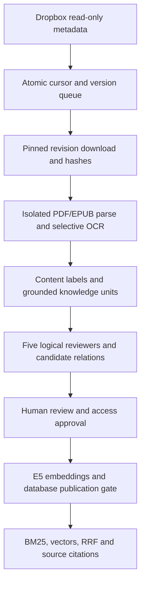

# IM19 Autonomous Knowledge Intelligence architecture

The existing PDF/video/Edge Function system remains separate. The new worker writes into private schema `im19` and the new retriever reads only published versions there. No automatic bridge into legacy `rag` retrieval is supplied.

## Modules and contracts

- `knowledge_mining/dropbox_discovery.py`: allowlisted reads, refresh-token OAuth, metadata normalization, bounded pagination/backoff, token failure classification, pinned-revision download and block-hash validation. Discovery does not download content. Source and cursor updates share one SQL transaction and use an optimistic cursor check.
- `document_processor.py`: PyMuPDF paragraphs, heading candidates, TOC context and table extraction; image-heavy low-text page routing to Tesseract with word-confidence aggregation. OCR confidence measures recognition, not truth. PDF pages are one-based. EPUB follows OPF spine and XHTML structure; reflowable EPUB cites spine/path, never fabricated pages. Image-only EPUB is flagged for human review; it does not yet OCR embedded EPUB images.
- `classifier.py`: per-chunk content-based hierarchical multi-label taxonomy; ambiguities require review. Supplied labels are validated against the configured hierarchy. Primary book category is not claimed as a calibrated document-level ranking.
- `mining_engine.py`: fourteen knowledge types; exact quotes bound to source chunks; deterministic IDs within version/model; confidence is null. Claim extraction may paraphrase, so exact quote matching alone does not prove entailment.
- `knowledge_review/review_engine.py`: five distinct system rubrics; schema rejection; exact provenance checks; explicit unverified status; comparisons from bounded same-concept published claims; pending context-aware relationship candidates. Reviewers can use the same local model and are not statistically independent. Unknown credibility/freshness remain null rather than invented values.
- `local_model.py`: GGUF hash validation, CPU llama.cpp, no tools/cloud, strict JSON, explicit context/output overflow. Prompts place source data in the user payload; models cannot execute source instructions. This reduces injection risk and is not a proof against every adversarial prompt.
- `storage/postgres.py`: version-aware identity, transactional metadata checkpoints, row-locked claims, unique jobs, lease fencing/heartbeats, stage read-back, evidence/graph persistence, and a separate approval read. Source deletion produces tombstones/superseded records, preserving history.
- `orchestrator.py`: durable stage machine; heartbeat thread during long work; retry/dead-letter status; SIGTERM stops further work at the next committed stage. Completed stages survive process loss; interrupted model stages may be repeated. Download files can be fetched again by pinned revision if a Colab disk is lost.
- `retrieval.py`: true BM25 over a bounded filtered corpus, 384D dense retrieval, RRF, optional injected reranker and reviewed graph expansion; title/author/category/concept/pages/review/credibility filters. BM25 refuses a corpus above the configured quota rather than silently truncating it. This pilot implementation is not an optimized global BM25 index for millions of chunks.
- `evaluation.py`: only explicitly reviewed labels yield Recall@5/MRR and supplied classification, extraction, evidence, contradiction, citation and unsupported-claim rates. Metrics remain null when the relevant labels/counts are absent.

## Data and publication

Entities: source connections/files, document versions, extraction runs, pages, chunks, units, claims/evidence, review runs/findings, human approvals, graph nodes/edges, embeddings, jobs and audit events. Node types include Document/Author/Concept/Claim/Evidence/Methodology/Category. Current persistence constructs document/claim/evidence/concept/category and methodology nodes; author enrichment remains partial because Dropbox metadata has no reliable author field. Graph expansion is additive and restricted to reviewed edges; AI relation candidates stay pending.

Two hashes serve different purposes: Dropbox's 4MiB block hash checks remote content identity; whole-file SHA-256 identifies the downloaded bytes. Exact-hash duplicates of already processed documents are held for review before a second download; concurrent first ingestions can still download identical sources, and semantic near-duplicate removal is not automatic.

The database independently checks current revision/hash, approved access, stored review identity, human approval, nonempty source-bound units, and a complete matching embedding set before publication. Human decisions bind to immutable review_run IDs. Worker credentials cannot create approval records or grant source access. A new source or revision starts hidden; a changed/deleted file supersedes older versions. There is no claim that an autonomous reviewer verifies external reality.

The pilot currently requires a human approval for every publication while the quality rubric and risk classifier are uncalibrated. High-risk/unknown cases therefore remain under human oversight. `NOT_EXTERNALLY_VERIFIED` survives approval and publication. A quality score is not a truth probability.

## Runtime

Colab is a development/batch runtime only. `python -m im19.cli worker --connection-id UUID` is the persistent worker command after deployment approval. Container example uses a restricted user, CPU/memory limits, read-only root filesystem, model mounts, secret mounts, durable downloads and database checkpoints. It has not been deployed or endurance-tested by this change.

Parser subprocesses have time/CPU/address-space limits on Linux and never extract archive paths. They are process isolation, not a complete OS sandbox against native-parser vulnerabilities. Deployment isolation and an adversarial native-library assessment remain release gates.
