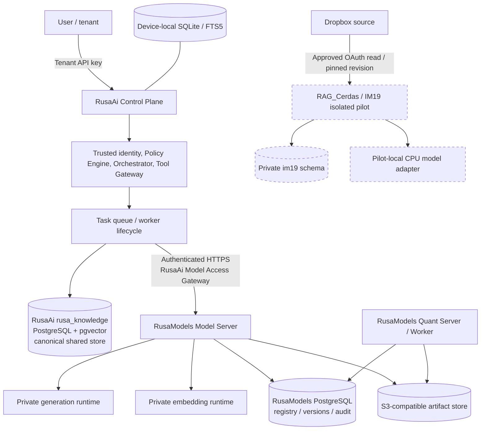
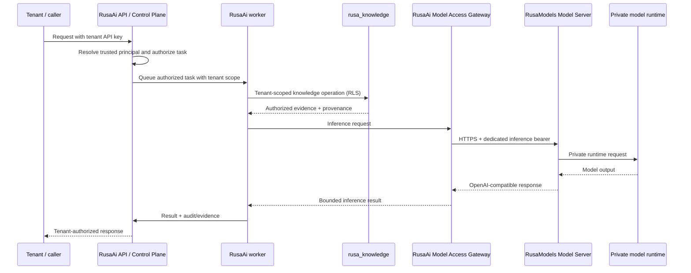
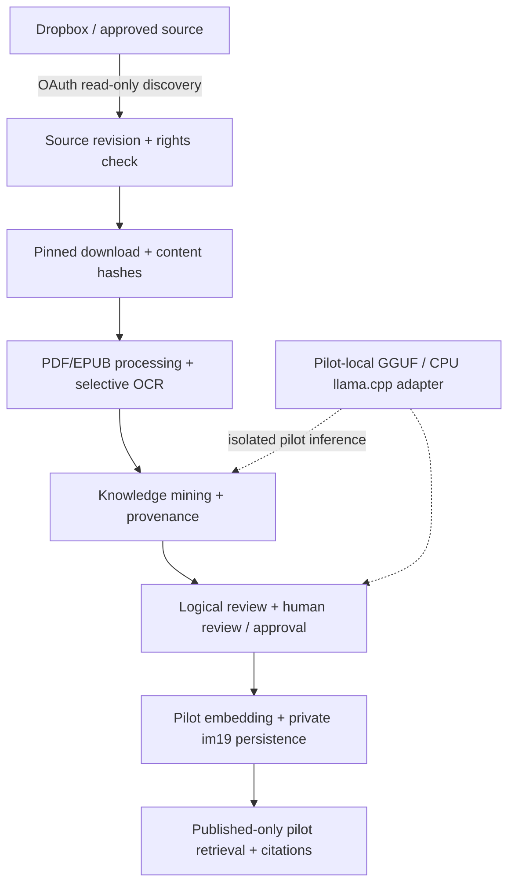
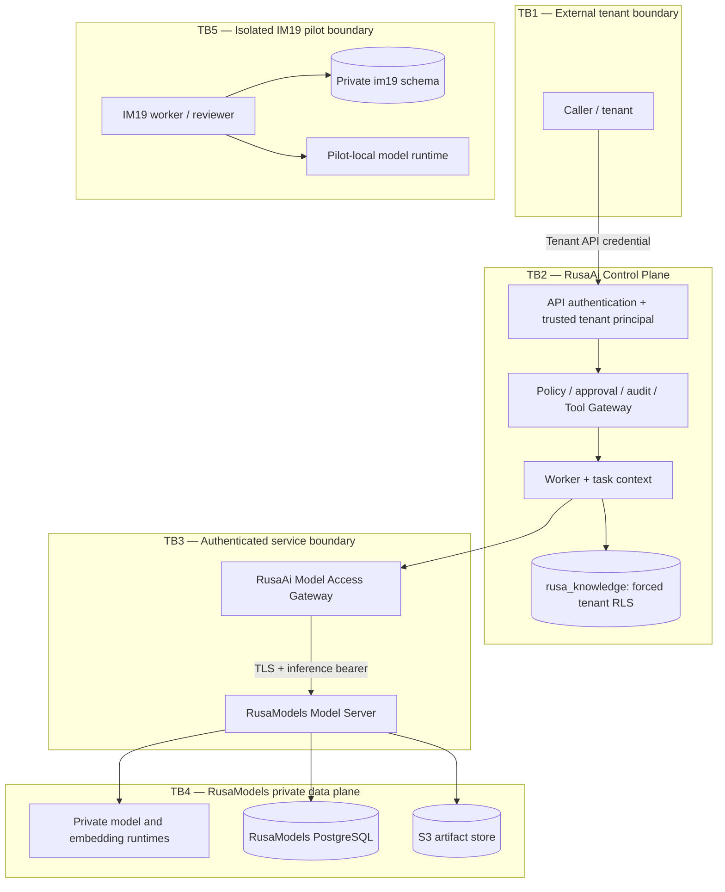

# RUSA AI Ecosystem — Architecture Reconciliation v1.0

- **Status:** Architecture/documentation alignment; not a production approval
- **Scope:** StrategyG/RusaAi, StrategyG/RusaModels, StrategyG/RAG_Cerdas
- **Primary authority:** RusaAi ADR-0002 — Canonical Shared Agent/Worker Knowledge Store
- **Companion alignment:** RAG_Cerdas ADR-0002 (proposed in PR #28)
- **Last repository snapshot:** 2026-11-13
- **Production status:** NO-GO; no production activation is authorized by this document

## 1. Decision summary

The ecosystem has three distinct ownership domains:

1. **RusaAi — Control Plane and canonical shared knowledge owner.** It owns trusted tenant identity, agent/task orchestration, policy, tool execution, workflow state, and the selected canonical shared Agent/Worker knowledge store, `rusa_knowledge`.
2. **RusaModels — Model Plane.** It owns model registry, immutable model artifacts, model serving, inference, embeddings, conversion, quantization, and model lifecycle evidence.
3. **RAG_Cerdas / IM19 — isolated Knowledge Intelligence pilot.** It owns its pilot source discovery, source-rights assessment, document processing, knowledge mining, review, provenance, and retrieval experiments. It is not the canonical shared Agent/Worker store or a public multi-tenant retrieval service.

SQLite/FTS5 remains device-local state and local full-text retrieval. It is not a second writer, replica, or synchronization target for the shared corpus.

RusaAi ADR-0002 selects `rusa_knowledge` for implementation planning. It does **not** establish that the store is fully governed, populated, deployed, or approved for production answer-facing retrieval. Production activation remains NO-GO until the stated release gates pass.

## 2. System context

The following diagram shows ownership and permitted service boundaries. It is an architecture view, not proof that all services are deployed or connected in a live environment.

**Isolation invariant:** there is no authorized edge from IM19 to `rusa_knowledge`, the RusaModels registry database, or the RusaModels artifact store. No cross-read, cross-write, dual-write, mirroring, bulk copy, or synchronization is authorized.

## 3. Service ownership matrix

| Capability / asset | Accountable owner | Consumers | Boundary / non-ownership |
|---|---|---|---|
| Tenant identity, API principals, tenant authorization | RusaAi | RusaAi API, workers, approved adapters | A model response or caller-supplied tenant ID is never an authorization source |
| Agent registry, planning, DAG/task orchestration, queue, scheduler, checkpoints | RusaAi | RusaAi agents and workers | RusaModels does not own agent workflow policy |
| Policy Engine, RBAC, approval, audit, Tool Gateway, sandbox | RusaAi | RusaAi runtime | RusaModels does not authorize agent tools or tenant tasks |
| Canonical shared Agent/Worker knowledge | RusaAi (`rusa_knowledge`) | Authorized RusaAi agents/workers | One canonical writer/retrieval authority after gates; no IM19 dual-write or cross-read |
| Device-local state and local full-text search | RusaAi device/runtime | Local RusaAi components | SQLite/FTS5 is not a shared-corpus replica |
| Model registry, versions, manifests, artifact hashes and retention | RusaModels | RusaModels services; authorized clients via API | No RusaAi database or object-store credentials |
| Model serving, inference and embeddings | RusaModels | RusaAi through authenticated Model Server API | RusaAi does not load production model weights or call private runtime ports |
| Conversion, quantization and model release evidence | RusaModels | RusaModels Model/Quant services | No agent orchestration or knowledge approval authority |
| IM19 source discovery, rights assessment, extraction/OCR, mining, review and pilot retrieval | RAG_Cerdas | IM19 pilot operators and workers | Isolated pilot only; no canonical-store ownership or public multi-tenant API |
| Dropbox source access for IM19 | Dropbox / authorized source owner; access workflow in RAG_Cerdas | IM19 discovery/processing | Read-only and source-rights gated; public availability is not archival permission |
| Cross-repository API contracts | Provider owns API; consumer owns client | Named provider/consumer pair | Contract status is recorded in Section 6; no implicit database or filesystem sharing |

## 4. Intended production data flow — RusaAi and RusaModels

This is the approved ownership path. It does not claim production deployment or activation.

Rules:

- The tenant identity is resolved by RusaAi from a verified credential and propagated through trusted task context. Model-generated values cannot select tenant, project, agent, or worker permissions.
- RusaAi calls the RusaModels Model Server over HTTPS using a dedicated principal with role `inference`. The worker must not receive the Model Server credential, database credentials, artifact-store credentials, or private runtime URL.
- RusaModels owns its PostgreSQL registry and S3-compatible artifact store. RusaAi consumes APIs; it does not connect directly to those stores.
- RusaAi's canonical knowledge store remains subject to source-rights, project/agent scope, human approval, publication, index-generation, deletion, restore, and retrieval-quality gates.
- A passing CI workflow or a documented endpoint is not proof of a live production deployment.

## 5. Isolated IM19 pilot data flow

- IM19 reads only authorized sources and preserves exact revision, hash, provenance, and rights state.
- The private `im19` schema and worker/retriever remain separate from RusaAi `rusa_knowledge`.
- The current IM19 database policy is private-role scoped and does not provide tenant columns/per-tenant RLS predicates. IM19 must not be represented as tenant-safe for public multi-tenant retrieval.
- A rights hold/reject quarantine is not the same as erasing blobs, extracted text, chunks, embeddings, caches, or backups. Purge/retention remains a release blocker.
- The existing `local_model.py` GGUF/CPU path is a pilot-local experimental runtime. It is not a second production Model Plane and has no authority to access RusaModels private artifacts or runtime services. **OPEN_DECISION:** whether future controlled IM19 model inference remains pilot-local or consumes RusaModels through a separately approved authenticated contract. No such integration is authorized now.
- IM19 has no approved data-flow path into RusaAi `rusa_knowledge`.

## 6. Cross-repository contract inventory

| Contract / interface | Provider → consumer | Current evidence | Status and limits |
|---|---|---|---|
| OpenAI-compatible Model Server API: `GET /openai/v1/models`, `POST /openai/v1/chat/completions`, `POST /openai/v1/embeddings` (streaming/completions are also documented) | RusaModels → RusaAi | RusaAi `docs/RUSAMODELS-INTEGRATION.md`; RusaModels `docs/RUSAAI-INTEGRATION.md`; RusaModels Model Server implementation and authenticated `inference` principal | **Implemented/documented API surface; live deployment NOT_VERIFIED.** This is the currently documented integration surface. |
| RusaAi v1 inference request/response JSON Schemas in `shared/contracts/inference_contract/` | RusaAi-owned envelope; intended for RusaAi inference boundary | Schema files exist on RusaAi main; its contract README says the existing OpenAI-compatible `/v1/chat/completions` endpoint has not yet been migrated to consume these envelopes directly | **Schema present; endpoint consumption NOT_IMPLEMENTED.** Do not claim provider/consumer conformance. |
| RusaAi ↔ RusaModels Model Plane custom v0.1 contract proposed in RusaAi PR #103 | Intended RusaAi consumer ↔ RusaModels provider | PR #103 is an open draft on RusaAi; it describes proposed OpenAPI/request/response/error schemas | **DRAFT / NOT_MERGED / provider conformance NOT_VERIFIED.** It is not a replacement for the current OpenAI-compatible API until both sides implement and test it. |
| RusaAi ↔ RAG_Cerdas / IM19 retrieval, ingestion, or data synchronization | None | No approved cross-repository service contract identified; RusaAi ADR-0002 and RAG_Cerdas alignment ADR prohibit implicit integration | **NO CONTRACT / NOT_AUTHORIZED.** Any future path requires a separate approved ADR, authenticated versioned contract, tenant/project scope, rights/provenance, deletion/reconciliation, security and evaluation evidence, and rollback. |
| RusaModels ↔ RAG_Cerdas shared model/artifact/database access | None | No cross-repository contract identified. IM19 currently documents a pilot-local GGUF/CPU adapter | **NO CONTRACT / NOT_AUTHORIZED.** IM19 must not access RusaModels databases, object-store credentials, or private runtime ports. |
| Dropbox OAuth/read-only source discovery | Dropbox → IM19 | RAG_Cerdas IM19 architecture and source-rights documentation | **External provider interface, not an ecosystem cross-repository contract.** Source access authorization and exact-version rights checks remain mandatory. |

### Contract change rules

1. Provider owns the server-side schema and compatibility policy; consumer owns its client and compatibility tests.
2. Any breaking change requires a versioned contract, migration/deprecation plan, consumer inventory, and compatibility tests.
3. A contract document or schema file is not proof that a server validates it.
4. A passing consumer unit test is not proof of provider conformance or live service availability.
5. No repository may access another repository's private database, artifact credentials, internal filesystem, or runtime port.

## 7. Trust boundaries and security invariants

Mandatory invariants:

- **Identity:** tenant/project/agent/worker scope comes from verified identity and server-side grants, never from model output or an untrusted request field.
- **RusaAi data:** enforce tenant scope in PostgreSQL using forced RLS and least-privilege roles; validate authorization for search, get, list, counts, version history, and deletion.
- **Model Plane:** use TLS and a dedicated `inference` principal; never distribute Model Server, PostgreSQL, or S3 credentials to agents/workers.
- **IM19:** keep private pilot roles and schema isolated; do not expose public multi-tenant retrieval without tenant/project schema, database-enforced predicates, and independent negative tests.
- **Source rights:** operational source access and rights decisions are separate; bind decisions to exact source revision and content hash.
- **Publication:** candidate, reviewed, approved, embedded, indexed, and published are separate states. AI reviewer roles are not independent human approval.
- **Deletion:** quarantine, tombstone, purge, index invalidation, cache invalidation, and backup retention are distinct lifecycle operations.
- **Untrusted evidence:** retrieved documents and model output are data, not system instructions or tool authorization.

## 8. ADR reconciliation register

| ADR | Repository | Decision / status | Ecosystem interpretation |
|---|---|---|---|
| ADR-0002 — Canonical Shared Agent/Worker Knowledge Store | RusaAi | Accepted by project owner for implementation planning; production activation not authorized | Selects RusaAi `rusa_knowledge` as the canonical shared store, subject to governance/security/release gates |
| ADR-0002 — RusaModels owns the Model Plane | RusaAi | Accepted for repository integration alignment | RusaModels is the only production Model Plane; its statement that the canonical store is unresolved is superseded by the separate canonical-store ADR |
| ADR-001 — Independent services and shared control plane | RusaModels | Accepted | Model Server and Quant Server remain separate service entry points using shared Model Plane PostgreSQL and S3-compatible artifact storage |
| ADR-0001 — Canonical RUSA AI knowledge store and RAG integration | RAG_Cerdas | Proposed historical comparison; superseded for ecosystem-level selection by the proposed RAG_Cerdas ADR-0002 alignment | Its no-selection hold point is no longer the ecosystem decision; retain comparative analysis as history |
| ADR-0002 — RAG_Cerdas Alignment with the RusaAi Canonical Knowledge Store | RAG_Cerdas | Proposed in RAG_Cerdas PR #28; not merged at the snapshot used for this audit | Aligns IM19 as an isolated pilot and prohibits implicit data movement or public multi-tenant exposure |

**ADR governance issue — OPEN_DECISION:** RusaAi currently has two files titled/numbered ADR-0002 in `docs/adr/`. Until a separately reviewed numbering correction is approved, references must use the full filename/title, not the ambiguous shorthand “RusaAi ADR-0002”. Do not silently renumber accepted decisions or break links.

## 9. Open decisions and release blockers

| ID | Owner | Status | Decision / evidence required |
|---|---|---|---|
| O-01 | RusaAi / RusaModels | OPEN_DECISION | Reconcile the draft custom Model Plane v0.1 contract with the currently implemented OpenAI-compatible API; implement provider and consumer conformance before calling it integrated |
| O-02 | RAG_Cerdas / RusaModels | OPEN_DECISION | Decide whether IM19's pilot-local GGUF runtime remains a strictly isolated research harness or is replaced by a separately approved RusaModels service integration |
| O-03 | RusaAi | OPEN_DECISION | Resolve duplicate ADR-0002 identifiers with an explicit index/renumbering plan |
| O-04 | RusaAi | BLOCKED | Complete source rights, source versions, review, human approval, publication, agent/project scope, index-generation reconciliation, and deletion/purge before canonical knowledge production activation |
| O-05 | RAG_Cerdas | BLOCKED | Tenant/project authorization, verified reviewer identity, purge/retention, human-reviewed qrels, representative load tests, and staging/restore evidence remain incomplete |
| O-06 | RusaModels | BLOCKED | Approved non-Qwen core checkpoint/artifact, target hardware runtime, soak, backup/restore, rollback, and production evidence remain incomplete |

## 10. Prohibited actions under this reconciliation

This document does not authorize:

- Production activation or public exposure of `rusa_knowledge` or IM19.
- Cross-read, cross-write, dual-write, mirroring, synchronization, bulk copying, or migration between RusaAi and IM19.
- Production DDL, database resets, source mutation, bulk ingestion, or embedding jobs.
- Sharing private database credentials, object-store credentials, model weights, or internal runtime URLs across repositories.
- Merging PRs, deploying services, or changing production secrets.
- Treating CI success as staging, scale, security, or production certification.

## 11. Source references

- RusaAi canonical knowledge decision: [ADR-0002 canonical shared knowledge store](https://github.com/StrategyG/RusaAi/blob/main/docs/adr/ADR-0002-canonical-shared-agent-worker-knowledge-store.md).
- RusaAi Model Plane boundary: [ADR-0002 RusaModels Model Plane boundary](https://github.com/StrategyG/RusaAi/blob/main/docs/adr/ADR-0002-rusamodels-model-plane-boundary.md).
- RusaAi ↔ RusaModels API integration: [RusaAi integration document](https://github.com/StrategyG/RusaAi/blob/main/docs/RUSAMODELS-INTEGRATION.md) and [RusaModels integration document](https://github.com/StrategyG/RusaModels/blob/main/docs/RUSAAI-INTEGRATION.md).
- RusaModels service ownership: [RusaModels architecture](https://github.com/StrategyG/RusaModels/blob/main/docs/architecture.md) and [ADR-001](https://github.com/StrategyG/RusaModels/blob/main/docs/ADR-001-shared-control-plane.md).
- IM19 pilot implementation boundary: [IM19 architecture](IM19_ARCHITECTURE.md), [source-rights procedure](IM19_SOURCE_RIGHTS.md), and [production readiness](PRODUCTION_READINESS.md).
- RAG_Cerdas alignment: [ADR-0002](ADR_0002_RUSAAI_CANONICAL_KNOWLEDGE_STORE_ALIGNMENT.md) and [roadmap v1.2](RUSA_AI_RAG_CERDAS_PRODUCTION_ROADMAP_v1.2.md).
